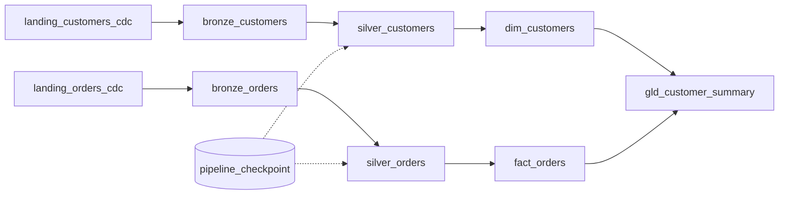

# E-commerce CDC pipeline

This dbt project turns customer and order change events into reporting data on Databricks. It keeps raw CDC history in Bronze, maintains the latest row per customer and order in Silver, and publishes a customer dimension, an order fact table, and a customer summary in Gold.

## Medallion architecture



| Layer | Relations | Incremental pattern | Incremental filter |
| --- | --- | --- | --- |
| Landing | `landing_customers_cdc`, `landing_orders_cdc` | Initial dbt seed, followed by append-only `INSERT INTO` batches. CDC updates and deletes arrive as new events. | No timestamp filter. Each insert supplies the new events. |
| Bronze | `bronze_customers`, `bronze_orders` | Databricks streaming tables read Landing with `FROM STREAM` and retain the raw CDC history. Bronze preserves `landing_ingested_at` and stamps each row with `bronze_ingested_at`. | No SQL watermark column. Databricks uses the stream's checkpoint to read newly appended Landing data. |
| Silver | `silver_customers`, `silver_orders` | Checkpoint-based incremental Delta merge. Silver casts fields, ranks events by `source_updated_at`, and carries deletes as `is_deleted`. Matched rows update only when the incoming `source_updated_at` is strictly newer. | **`bronze_ingested_at`**. Read events strictly newer than `last_successful_ingested_at - INTERVAL 6 HOURS` and at or below the fixed upper bound captured as `MAX(bronze_ingested_at)`. A null checkpoint skips the lower bound. |
| Gold | `dim_customers`, `fact_orders` | Target-watermark incremental Delta merge. Each model retains soft deletes and generates surrogate keys with `dbt_utils.generate_surrogate_key`. Matched rows update only when the incoming `silver_updated_at` is strictly newer. | **`silver_updated_at`**. Read Silver rows at or after `MAX(silver_updated_at) - INTERVAL 6 HOURS`, where the maximum comes from the corresponding Gold table. An empty target skips the lower bound. |
| Reporting | `gld_customer_summary` | Databricks-managed materialized view refresh. The view joins the dimension and fact on `customer_sk` and reports lifetime order metrics, including customers with no orders. | No custom watermark column. Databricks chooses the refresh strategy. The view uses `is_deleted = false` to exclude soft-deleted customers and orders from reporting. |

Silver and Gold match orders by `(order_id, order_date)` and customers by `(customer_id, customer_creation_date)`. Silver derives `customer_creation_date` from `source_created_at`. The business dates must be available on all CDC events, including deletes, and remain stable for a given key. Distinct events for the same key should have distinct `source_updated_at` values because the Silver ranking orders by that timestamp alone.

## Set up the dbt environment from scratch

### 1. Open the project and create a Python environment

Install Python 3.11 if `python3.11 --version` is unavailable. Open a terminal in the project root, the directory containing `dbt_project.yml`, and run:

```bash
python3.11 -m venv .venv
source .venv/bin/activate
python -m pip install --upgrade pip
python -m pip install "dbt-core==1.12.5" "dbt-databricks==1.12.8"
dbt --version
```

In a new terminal, return to the project root and run `source .venv/bin/activate` again. Both dbt and the Silver runner use this environment.

### 2. Configure the Databricks target

Choose a writable Unity Catalog catalog and schema. In Databricks, open the SQL warehouse's connection details and copy its **Server Hostname** and **HTTP Path**. Use a warehouse that supports streaming tables and materialized views.

In `profiles.yml`, configure the `ecommerce_dbt_project_final` profile. The name matches the `profile` setting in `dbt_project.yml`. This example uses an environment variable for the Databricks token:

```yaml
ecommerce_dbt_project_final:
  target: dev
  outputs:
    dev:
      type: databricks
      host: "<server-hostname>"
      http_path: "<warehouse-http-path>"
      token: "{{ env_var('DATABRICKS_TOKEN') }}"
      catalog: "<catalog>"
      schema: "<schema>"
      threads: 2
```

Replace the placeholders with your warehouse and target details. Load the token from your credential store, or enter it without echoing it in Bash or Zsh:

```bash
printf 'Databricks token: '
read -rs DATABRICKS_TOKEN
printf '\n'
export DATABRICKS_TOKEN
```

### 3. Install dbt packages and verify the connection

Run these commands from the project root. Setting `DBT_PROFILES_DIR` also makes the profile available to the dbt commands launched by the Silver runner.

```bash
export DBT_PROFILES_DIR="$PWD"
dbt deps
dbt debug
```

`dbt deps` installs the project's pinned `dbt_utils` package. Confirm that `dbt debug` succeeds and shows the intended catalog and schema before loading data. For a first run, use a fresh schema so the seed commands do not overwrite existing landing tables.

## Run the incremental path

### First run in a fresh schema

Initialize the landing tables and both Silver checkpoint rows:

```bash
dbt seed --select landing_customers_cdc landing_orders_cdc
dbt run-operation create_pipeline_checkpoint
```

Use `dbt seed` for initial setup. For subsequent batches, append CDC rows to the existing landing tables. Rerunning `dbt seed` overwrites landing data and can interrupt an established Bronze stream.

### First and subsequent batches

1. Create or refresh the Bronze streams.

   ```bash
   dbt run --select bronze_customers bronze_orders
   ```

2. Run the checkpointed Silver pipelines. Run each command only after the previous command succeeds.

   ```bash
   python scripts/run_silver.py customers
   python scripts/run_silver.py orders
   ```

3. Build and test Gold, including the reporting materialized view.

   ```bash
   dbt build --select dim_customers fact_orders gld_customer_summary
   ```

### How Silver checkpoints work

`pipeline_checkpoint` stores separate rows for `customers_bronze_to_silver` and `orders_bronze_to_silver`. The runner reads the last successful watermark and captures the current maximum `bronze_ingested_at` as the run's upper bound. A first run with a null watermark reads all Bronze rows through the upper bound. Later runs read rows strictly newer than the previous watermark minus six hours and at or below the captured upper bound.

The runner marks the pipeline `RUNNING`, validates the Bronze table, passes the captured window to the Silver merge, and runs the Silver uniqueness and required-field check. It advances the watermark only after those steps pass. A processing failure records `FAILED` and preserves the previous successful watermark. An empty Bronze source also preserves the watermark. If a Silver check fails after the merge commits, rerun the same pipeline after correcting the failure. The strict update condition prevents a replayed event from changing an already-applied row.

Use the Python runner for checkpointed runs. A direct `dbt build --select silver` can build and test Silver but leaves the checkpoints untouched. Run only one execution of a given pipeline at a time, including backfills.

## Run a business-date backfill

A backfill repairs current Silver state from existing Bronze CDC history. It can insert missing keys or apply newer events using the same Silver merge rules. The date window uses an inclusive start and exclusive end and does not change the incremental checkpoint.

| Pipeline | Business date |
| --- | --- |
| Customers | `customer_creation_date`, derived from `source_created_at` |
| Orders | `order_date` |

1. Confirm that the Silver target already exists and that Bronze contains the relevant events. If historical events are missing from Bronze, append them to Landing and refresh the corresponding Bronze stream.
2. Pass both dates to the Silver runner. This example reprocesses **November 1, 2026**. Run the pipeline or pipelines you need.

   ```bash
   python scripts/run_silver.py customers --start-date 2026-11-01 --end-date 2026-11-02
   python scripts/run_silver.py orders --start-date 2026-11-01 --end-date 2026-11-02
   ```

   The runner validates the selected Bronze date range, merges the latest event per key into Silver, and runs the Silver data test. It skips checkpoint operations in backfill mode.

3. Refresh Gold after Silver passes. Gold picks up changed rows through their new `silver_updated_at` values, so the Gold build uses its regular incremental logic.

   ```bash
   dbt build --select dim_customers fact_orders gld_customer_summary
   ```

4. Verify the affected Silver rows and compare the checkpoint before and after the backfill. Both the last successful watermark and checkpoint status should stay the same.

```sql
SELECT pipeline_name, pipeline_status, last_successful_ingested_at, updated_at
FROM pipeline_checkpoint
ORDER BY pipeline_name;
```

## Tests and reconciliation

Run the Python backfill runner unit tests locally. They mock dbt commands:

```bash
python -B -m unittest discover -s tests/unit -v
```

Run the dbt unit tests against Databricks with the pipeline's Bronze and Silver relations in place:

```bash
dbt test --select test_type:unit
```

After refreshing Gold, run the plain SQL files in [`analysis/`](analysis/) in the pipeline catalog and schema. The customer and order queries compare Silver rows with their Gold counterparts. The customer summary query derives expected lifetime metrics from the latest Bronze CDC state and compares them with Gold. Zero rows means the data reconciles. `EXPECTED_ONLY` shows the expected row and `ACTUAL_ONLY` shows the row present in Gold when there is a discrepancy.

## Table schemas

These are the Databricks column types defined by the seed configuration, model contracts, SQL projections, and checkpoint DDL.

### Landing

#### `landing_customers_cdc`

| Column | Data type |
| --- | --- |
| `customer_id` | `BIGINT` |
| `customer_name` | `STRING` |
| `email` | `STRING` |
| `city` | `STRING` |
| `customer_status` | `STRING` |
| `source_created_at` | `TIMESTAMP` |
| `source_updated_at` | `TIMESTAMP` |
| `cdc_operation` | `STRING` |
| `landing_ingested_at` | `TIMESTAMP` |

#### `landing_orders_cdc`

| Column | Data type |
| --- | --- |
| `order_id` | `BIGINT` |
| `customer_id` | `BIGINT` |
| `order_amount` | `DECIMAL(18,2)` |
| `order_status` | `STRING` |
| `order_date` | `DATE` |
| `source_created_at` | `TIMESTAMP` |
| `source_updated_at` | `TIMESTAMP` |
| `cdc_operation` | `STRING` |
| `landing_ingested_at` | `TIMESTAMP` |

### Bronze

#### `bronze_customers`

| Column | Data type |
| --- | --- |
| `customer_id` | `STRING` |
| `customer_name` | `STRING` |
| `email` | `STRING` |
| `city` | `STRING` |
| `customer_status` | `STRING` |
| `source_created_at` | `STRING` |
| `source_updated_at` | `STRING` |
| `cdc_operation` | `STRING` |
| `landing_ingested_at` | `TIMESTAMP` |
| `bronze_ingested_at` | `TIMESTAMP` |

#### `bronze_orders`

| Column | Data type |
| --- | --- |
| `order_id` | `STRING` |
| `customer_id` | `STRING` |
| `order_amount` | `STRING` |
| `order_status` | `STRING` |
| `order_date` | `STRING` |
| `source_created_at` | `STRING` |
| `source_updated_at` | `STRING` |
| `cdc_operation` | `STRING` |
| `landing_ingested_at` | `TIMESTAMP` |
| `bronze_ingested_at` | `TIMESTAMP` |

### Silver

#### `silver_customers`

| Column | Data type |
| --- | --- |
| `customer_id` | `BIGINT` |
| `customer_name` | `STRING` |
| `email` | `STRING` |
| `city` | `STRING` |
| `customer_status` | `STRING` |
| `customer_creation_date` | `DATE` |
| `source_created_at` | `TIMESTAMP` |
| `source_updated_at` | `TIMESTAMP` |
| `cdc_operation` | `STRING` |
| `is_deleted` | `BOOLEAN` |
| `silver_created_at` | `TIMESTAMP` |
| `silver_updated_at` | `TIMESTAMP` |

#### `silver_orders`

| Column | Data type |
| --- | --- |
| `order_id` | `BIGINT` |
| `customer_id` | `BIGINT` |
| `order_amount` | `DECIMAL(18,2)` |
| `order_status` | `STRING` |
| `order_date` | `DATE` |
| `source_created_at` | `TIMESTAMP` |
| `source_updated_at` | `TIMESTAMP` |
| `cdc_operation` | `STRING` |
| `is_deleted` | `BOOLEAN` |
| `silver_created_at` | `TIMESTAMP` |
| `silver_updated_at` | `TIMESTAMP` |

### Gold

#### `dim_customers`

| Column | Data type |
| --- | --- |
| `customer_sk` | `STRING` |
| `customer_id` | `BIGINT` |
| `customer_name` | `STRING` |
| `email` | `STRING` |
| `city` | `STRING` |
| `customer_status` | `STRING` |
| `customer_creation_date` | `DATE` |
| `source_created_at` | `TIMESTAMP` |
| `source_updated_at` | `TIMESTAMP` |
| `is_deleted` | `BOOLEAN` |
| `silver_updated_at` | `TIMESTAMP` |

#### `fact_orders`

| Column | Data type |
| --- | --- |
| `order_sk` | `STRING` |
| `order_id` | `BIGINT` |
| `customer_sk` | `STRING` |
| `customer_id` | `BIGINT` |
| `order_amount` | `DECIMAL(18,2)` |
| `order_status` | `STRING` |
| `order_date` | `DATE` |
| `source_created_at` | `TIMESTAMP` |
| `source_updated_at` | `TIMESTAMP` |
| `is_deleted` | `BOOLEAN` |
| `silver_updated_at` | `TIMESTAMP` |

#### `gld_customer_summary` (materialized view)

| Column | Data type |
| --- | --- |
| `customer_sk` | `STRING` |
| `customer_id` | `BIGINT` |
| `customer_name` | `STRING` |
| `city` | `STRING` |
| `customer_status` | `STRING` |
| `total_orders` | `BIGINT` |
| `completed_orders` | `BIGINT` |
| `completed_sales_amount` | `DECIMAL(28,2)` |
| `cancelled_orders` | `BIGINT` |
| `refunded_orders` | `BIGINT` |
| `latest_order_date` | `DATE` |

### Checkpoint

#### `pipeline_checkpoint`

| Column | Data type |
| --- | --- |
| `pipeline_name` | `STRING` |
| `source_table` | `STRING` |
| `target_table` | `STRING` |
| `last_successful_ingested_at` | `TIMESTAMP` |
| `last_run_started_at` | `TIMESTAMP` |
| `last_run_completed_at` | `TIMESTAMP` |
| `pipeline_status` | `STRING` |
| `error_message` | `STRING` |
| `created_at` | `TIMESTAMP` |
| `updated_at` | `TIMESTAMP` |
